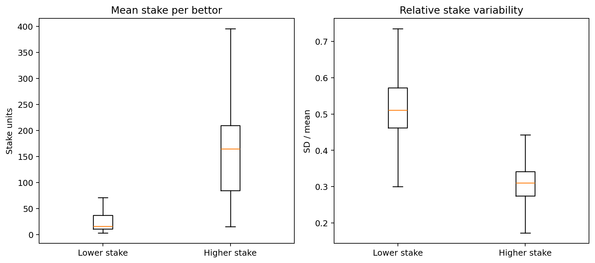
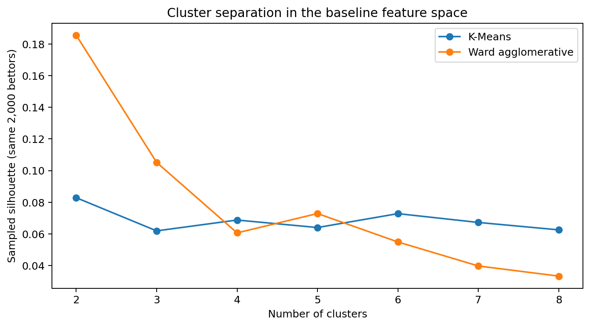
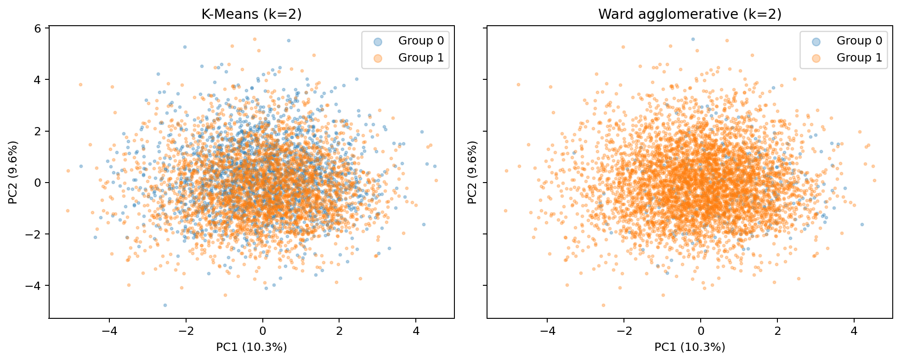
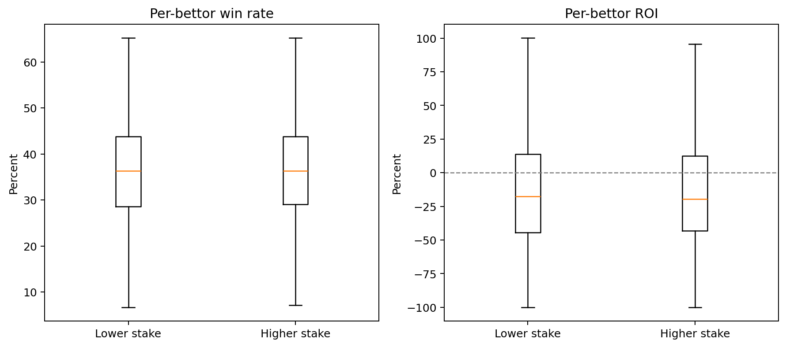

# Sports Betting Behavioral Profiling — Final Analysis Draft

**Research question:** Can simulated sports betting records reveal distinct behavioral profiles, and how does observed betting performance vary across those profiles?

## Abstract

We analyzed 100,000 simulated bets from 5,000 bettors. After aggregating betting behavior to the bettor level, we compared K-Means and Ward hierarchical agglomerative clustering. A two-group K-Means solution primarily distinguished average stake and relative stake variability, but separation was weak (sampled silhouette 0.0829). Ward clustering instead isolated a small group of bettors who had placed cycling bets. Assignments therefore depended on the algorithm and preprocessing. Both K-Means groups had negative average returns; the higher-stake group lost more currency units, while win rate and ROI were similar. These results support a descriptive segmentation of this synthetic sample, rather than evidence of distinct real-world bettor types or betting skill.

## 1. Data and preparation

The Kaggle sports betting profiling dataset contains 100,000 simulated bets by 5,000 bettors. Its nine fields are bet ID, user ID, bet type, sport, decimal odds, win indicator, stake, gain, and gross gaming revenue (GGR). Each bettor has 6–39 recorded bets. There are 13 sports and two bet types.

Checks found no missing cells, duplicate records, duplicate bet IDs, nonpositive stakes, decimal odds at or below one, or invalid binary win indicators. On all records, `gain` matched `stake × odds` for wins and zero for losses, allowing 0.011 currency units for rounding. GGR matched `stake − gain` with the same tolerance. Therefore:

- Bettor net profit = sum(gain − stake) = −sum(GGR).
- Win rate = wins / recorded bets.
- Average net profit per bet = net profit / recorded bets.
- Bettor ROI = net profit / total stake.

These definitions are verified from the provided records; they do not establish the mechanism that generated the synthetic outcomes. No currency is specified, so monetary results are reported in stake units.

## 2. Features and methods

We created the original 23 bettor-level features from the Phase 2 notebook. These describe recorded bet count, stake, odds, sports diversity, bet-type diversity, and sport/bet-type shares. The count is an activity measure within this dataset; without timestamps or exposure durations it is not a temporal betting frequency.

For the baseline model we replaced raw stake standard deviation with its coefficient of variation (SD / mean), removed median stake, the single-bet share, and bet-type diversity, and retained 20 features. Average stake and odds variance were transformed with `log1p`; all retained features were standardized. IDs and financial outcomes were excluded from clustering. Sport proportions sum to one and remain dependent; scaling rare sports can give them substantial influence, which motivated sensitivity checks.

K-Means was run for k = 2–8 with 50 initializations and seed 42. Ward agglomerative clustering was evaluated for the same k values using Euclidean distances in the same standardized feature space. Separation was assessed on the same random sample of 2,000 bettors using silhouette scores. Adjusted Rand index (ARI) compared assignments across methods and random seeds. A higher silhouette alone was not treated as proof of useful profiles.

Five preprocessing specifications were examined at k = 2: baseline log-plus-standard scaling, robust scaling after the same log transforms, downweighting the 13 standardized sport columns by 1/√13, omitting average stake and relative stake variability, and standard scaling without log transforms. Silhouette values from different feature spaces are not directly comparable as model rankings.

Performance comparisons use one observation per bettor. We report both equally weighted mean bettor ROI and pooled ROI (total group profit / total group stake); these answer different questions. Exploratory 95% percentile bootstrap intervals for differences in means used 3,000 resamples of bettors within each fixed cluster. These intervals are conditional on the fitted groups and do not capture uncertainty from learning clusters or imply generalization from synthetic records to real bettors. Multiple metrics were explored; no confirmatory hypothesis-testing claim is made.

## 3. Results

### K-Means profiles

K-Means k = 2 had the highest sampled silhouette among its tested values (0.0829). This indicates weak separation, rather than sharply distinct groups. For readable labels, final group IDs are ordered by increasing mean stake. This reverses the numerical labels in the Phase 2 outputs; membership is unchanged.

| Measure | Lower average stake (group 0) | Higher average stake (group 1) |
|---|---:|---:|
| Bettors | 1,871 | 3,129 |
| Mean stake per bettor | 23.15 | 197.09 |
| Mean relative stake variability | 0.522 | 0.308 |
| Mean recorded bets | 19.91 | 20.05 |
| Mean odds | 4.71 | 4.69 |

Sport preferences and bet-type proportions were similar between these groups. The first two principal components explained only 19.94% of variance and showed substantial overlap. PCA is a visualization of the full 20-feature clustering, not the space used to fit the models.

Across five random seeds with 50 initializations, pairwise ARI ranged from 0.9968 to 1.0000. This supports numerical consistency under those settings. It does not establish strong separation or robustness to different modeling assumptions.

### Hierarchical comparison and feature sensitivity

Ward k = 2 produced a silhouette of 0.1856, with 291 and 4,709 bettors. All 291 bettors in the small group had at least one cycling bet; five other cycling bettors remained in the larger group. Cycling accounted for only 304 bets overall, illustrating the effect of standardizing a rare sport share. Agreement with K-Means was very low (ARI 0.0019). A larger silhouette here therefore reflected a different split, not confirmation of the same stake profiles.

| Sensitivity specification | ARI relative to baseline K-Means |
|---|---:|
| Robust scaling with log transforms | 0.9792 |
| Downweighted sport block | 0.9848 |
| Omit stake features | 0.0005 |
| Standard scaling without log transforms | 0.0065 |

The baseline split was similar under robust scaling and sport downweighting but changed strongly when stake features were removed or logarithmic transformations were omitted. It is a useful description under one defensible specification, not a uniquely determined underlying segmentation.

### Observed betting performance

| Measure | Lower average stake | Higher average stake |
|---|---:|---:|
| Mean bettor win rate | 36.55% | 36.39% |
| Mean net profit per bettor (stake units) | −42.54 | −401.08 |
| Mean net profit per bet (stake units) | −2.15 | −19.98 |
| Mean bettor ROI | −9.69% | −10.42% |
| Pooled ROI | −9.14% | −10.13% |
| Share of bettors with positive net profit | 33.99% | 34.20% |

The higher-minus-lower mean win-rate difference was −0.16 percentage points (exploratory 95% bootstrap interval −0.78 to 0.47). The mean bettor ROI difference was −0.73 percentage points (−3.51 to 2.06). These intervals include zero; the analysis does not establish a difference in win rate or ROI, nor does it establish that the groups are equivalent.

Mean net profit differed by −358.54 stake units per bettor (−440.64 to −274.51), and mean profit per bet differed by −17.83 (−22.05 to −13.55). Larger absolute losses are consistent with larger stake exposure. They do not demonstrate poorer skill or a causal effect of group membership.

## 4. Discussion and limitations

The research question receives a qualified answer. Clustering can create interpretable groups in these records, especially along stake behavior, but the evidence for distinct, stable behavioral types across specifications is limited. Numerical seed stability and weak geometric separation can coexist. Hierarchical results also show why an appealing score must be interpreted alongside group sizes and feature profiles.

The dataset is simulated, contains relatively few records per bettor, and supplies no time axis or observation duration. We cannot infer real-world motivations, gambling harm, betting skill, causal mechanisms, or future performance. Profiles and performance are derived from the same recorded period; this is descriptive analysis without held-out predictive validation. ROI is volatile with short histories. Conditional bootstrap intervals and the small set of sensitivity specifications do not resolve these limitations.

## 5. Conclusion

The baseline K-Means model divides this synthetic sample mainly into lower- and higher-stake groups with substantial overlap. Those groups have similar observed win rates and ROI, while higher stakes correspond to larger monetary losses. An alternative algorithm and preprocessing choices can produce very different assignments. The main contribution is a reproducible comparison of behavioral segmentation choices and observed returns, with explicit limits on what the clusters establish.

## Reproducibility and figures

Run `python final_analysis.py` from the repository after installing `requirements.txt`. Results are written to `outputs/final/`; Phase 2 files remain unchanged. Run settings and package versions are recorded in `run_metadata.json`.

1. `method_comparison.png`: silhouette by method and cluster count.
2. `method_pca.png`: overlapping groups in the same PCA projection.
3. `stake_profiles.png`: stakes and relative variability by K-Means profile.
4. `performance_distributions.png`: distributions of win rate and ROI (boxplot outliers hidden for readability, no observations removed from calculations).

## References

- Emilien Coicaud. Sports Betting Profiling Dataset. Kaggle. https://www.kaggle.com/datasets/emiliencoicaud/sports-betting-profiling-dataset
- Project source and reproducible analysis. https://github.com/leslieortega-us/Sports-Betting-Behavioral-Profiling

**Submission note:** This draft covers the analytical work. Add group member information, apply the instructor's final-report formatting/citation requirements, and review all wording as a group before submission.
